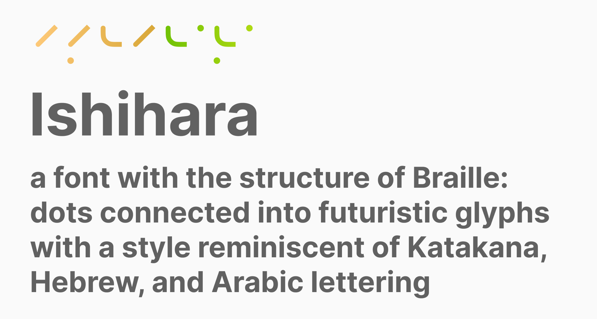
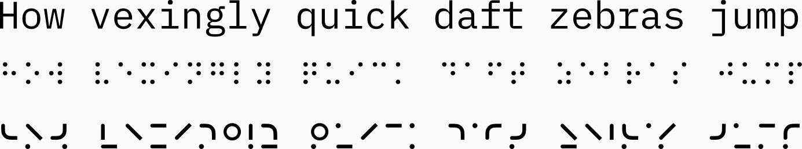

# Ishihara

A font with the structure of Braille: dots connected into futuristic glyphs, with a style reminiscent of Katakana, Hebrew, and Arabic lettering.

## Design

Each glyph is the Braille cell for its letter, with the dots joined into strokes.

- The upper four dots render as a connected set. Letters 1–10, 11–20, and 21–26 share upper sections, so those shapes repeat with dot annotations for the later letters.
- Lower dots are connected when there are more than one.
- Connected dots let some letters condense to a single column (a, b, k, l).
- Glyphs are top anchored, not baseline anchored. Braille is never written by hand, so there are no calligraphic strokes to inherit.
- W is a special case: it was not in the French alphabet Braille was designed for.
- Numbers are the first ten letters, prefixed with `#`.
- Punctuation is custom, partly derived from Braille.

## Files

- [`fonts/Ishihara-Regular.otf`](fonts/Ishihara-Regular.otf): version 0.1
- Source: [Figma](https://www.figma.com/design/AZsfl5jUw7tFm9X09TArFH/Ishihara)

Ishihara ships in [Chronograph](https://github.com/arfct/chronograph) as one of its obfuscation modes.

## License

[SIL Open Font License 1.1](OFL.txt). The font can be used, embedded, modified, and redistributed, including in commercial work. It cannot be sold on its own, and modified versions must stay under the OFL.
